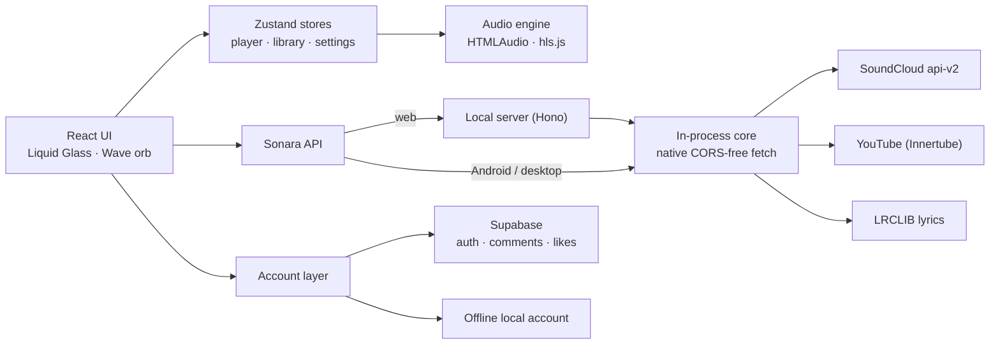

<div align="center">


# Sonara

**SoundCloud and YouTube in one music app — with an endless Wave that learns your taste, synced lyrics, comments inside tracks and an iOS 26 Liquid Glass interface.**

Android · iOS · Windows · macOS · Linux (glibc & musl)

[](https://github.com/Artyom151/sonara/releases/latest)
[](https://github.com/Artyom151/sonara/actions/workflows/release.yml)
[](https://github.com/Artyom151/sonara/actions/workflows/ci.yml)
[](LICENSE)
[](https://github.com/Artyom151/sonara/releases)

**English** · [Русский](README_ru.md)

<br />


&nbsp;&nbsp;


</div>

---

## Highlights

<table>
<tr>
<td width="50%" valign="top">

### Wave — an endless live playlist
Type an artist, a track, a genre or a mood — Sonara builds a stream of tracks that match its **style** (genres, tags, related-track graphs, artists, tempo of your listening) and keeps it going forever. Skips, likes and full listens reshape the Wave in real time. Every pick shows *why* it was chosen.

</td>
<td width="50%" valign="top">

### Liquid Glass, for real
The interface is built around a **WebGL2 port of a custom glass shader**: lens refraction, rim light, inner glow and shadow are computed per element and composited over the live page. iOS 26-style toggles, segmented controls, pull-down menus and sheets — with a plasma Wave orb that flares when you like a track.

</td>
</tr>
<tr>
<td valign="top">

### Two catalogues, one library
SoundCloud (the public client id is obtained automatically) and YouTube in one search, one queue and one set of playlists. Trending by genre, curated mixes, YouTube charts and **Picks for you** built from your own likes.

</td>
<td valign="top">

### Social, inside the player
**Synced lyrics** (LRCLIB), **timed comments** — tap a timestamp to jump there — and **"Liked by"** with the avatars of Sonara listeners. Sign in with the cloud (Supabase) or keep a fully offline local account.

</td>
</tr>
<tr>
<td valign="top">

### Feels native on every platform
**Android:** Material You colours from your wallpaper, themed icon, background playback with a media notification and lock-screen controls.
**Desktop:** frameless window, icon rail, glass player bar, Discord Rich Presence, low-memory mode while minimised.

</td>
<td valign="top">

### Light on the device
Lazy-loaded backend (the YouTube client loads only when needed), throttled storage writes, isolated re-renders, three graphics tiers (Maximum / Balanced / Battery saver) chosen automatically, and a background trim that releases caches and GPU contexts.

</td>
</tr>
</table>

## Screenshots

<table>
<tr>
<td><br /><sub><b>Wave</b> — moods, genres or any query</sub></td>
<td><br /><sub><b>Player</b> — lyrics and comments column</sub></td>
</tr>
<tr>
<td><br /><sub><b>Search</b> — SoundCloud + YouTube together</sub></td>
<td><br /><sub><b>Likes</b> — liked songs and your playlists</sub></td>
</tr>
<tr>
<td><br /><sub><b>Full-screen player</b> — colours from the artwork</sub></td>
<td><br /><sub><b>Profile</b> — avatar, username, stats</sub></td>
</tr>
</table>

<p align="center">


</p>

## Download

Get the latest build from **[Releases](https://github.com/Artyom151/sonara/releases/latest)**.

| Platform | File | Notes |
|---|---|---|
| Android 7.0+ | `Sonara-x.y.z-android.apk` | Allow installs from this source. `.aab` is for Google Play. |
| iOS 15+ | `Sonara-x.y.z-ios-unsigned.ipa` | Unsigned — install with AltStore / Sideloadly, or sign with your own certificate. |
| Windows 10/11 | `Sonara_x.y.z_x64-setup.exe` or `.msi` | WebView2 is installed automatically if missing. |
| macOS 11+ | `Sonara_x.y.z_universal.dmg` | Apple Silicon + Intel. Unsigned: right-click the app → **Open** the first time. |
| Linux (glibc) | `.AppImage`, `.deb`, `.rpm` | Ubuntu, Debian, Fedora, Arch… Needs GStreamer good/bad/libav plugins for playback. |
| Linux (musl) | `Sonara-x.y.z-linux-musl-x86_64.tar.gz` | Alpine and other musl systems — see `INSTALL.txt` inside. |

## Build from source

**Requirements:** Node 22+, pnpm 11, and per target: Rust (stable) for desktop, JDK 21 + Android SDK for Android, Xcode 16 for iOS.

```bash
pnpm install
cp .env.example .env          # optional: Supabase + Discord, see below
pnpm dev                      # web app + local API server → http://localhost:5173
```

| Target | Command | Output |
|---|---|---|
| Desktop (dev) | `pnpm desktop:dev` | Tauri window with hot reload |
| Desktop (release) | `pnpm desktop:build` | `src-tauri/target/release/bundle/` |
| Android (debug) | `pnpm android:debug` | `android/app/build/outputs/apk/debug/` |
| Android (release) | `pnpm android:keystore` once, then `pnpm android:build` | signed `app-release.apk` |
| iOS | `pnpm build && npx cap sync ios && npx cap open ios` | build in Xcode |
| Web (self-hosted) | `pnpm build && pnpm start` | `http://127.0.0.1:8787` |
| Phone layout smoke test | `pnpm build && pnpm smoke:android` | checks on ~6.1" screens → `smoke-results/` |

<details>
<summary><b>Linux and Alpine (musl) notes</b></summary>

- **Debian/Ubuntu:** `sudo apt install libwebkit2gtk-4.1-dev libgtk-3-dev librsvg2-dev build-essential gstreamer1.0-plugins-good gstreamer1.0-plugins-bad gstreamer1.0-libav`
- **Alpine:** `apk add webkit2gtk-4.1-dev gtk+3.0-dev librsvg-dev build-base gst-plugins-good gst-plugins-bad gst-libav`, then `pnpm tauri build --no-bundle`. `src-tauri/.cargo/config.toml` already disables static linking on musl targets.
- **Android on Alpine:** `pnpm android:*` picks a JDK 21 automatically and uses the SDK's `aapt2` (needs `gcompat`), because the Maven AAPT2 is glibc-only.

</details>

## Configuration

Everything is optional — without a backend Sonara runs with a local account.

| Variable (`.env`) | Purpose |
|---|---|
| `VITE_SUPABASE_URL`, `VITE_SUPABASE_PUBLISHABLE_KEY` | Cloud accounts, comments, likes sync, avatars. |
| `VITE_DISCORD_APP_ID` | Discord Rich Presence on desktop (Application ID from the Discord Developer Portal). |
| `VITE_API_BASE` | Web build only: URL of a remote Sonara API server. |

**Supabase:** run the SQL files in [`supabase/migrations`](supabase/migrations) in order (Dashboard → SQL Editor, or `npx supabase db push`). They create profiles, comments, likes, the `avatars` storage bucket, row-level security and realtime.

**Discord:** create an application at [discord.com/developers](https://discord.com/developers/applications), put its Application ID in `.env` (or in Settings → Discord), and upload `assets/discord-sonara.png` as a Rich Presence art asset named `sonara`.

## How it works



<details>
<summary><b>Project structure</b></summary>

```
src/
  core/          SoundCloud, YouTube, lyrics, recommendations backend (runs in-process or in server/)
  player/        audio engine, Wave engine, personal picks, audio analyser
  account/       Supabase + offline providers, comments, likes sync
  ui/            screens, desktop shell, iOS 26 controls, Liquid Glass runtime (ui/glass)
  platform/      native fetch, graphics tiers, memory trim, Android media controls, Discord
server/          Hono API server for the web build
src-tauri/       desktop app (Rust): Discord RPC, WebView2 memory level
android/ ios/    Capacitor projects (Dynamic Color plugin, media service)
supabase/        SQL migrations
scripts/         icons, release notes, version sync, Android build helpers, smoke test
```

</details>

## Releasing

1. Add your changes under `## [x.y.z]` in **both** [`CHANGELOG.md`](CHANGELOG.md) and [`CHANGELOG_ru.md`](CHANGELOG_ru.md).
2. Tag and push: `git tag v1.1.0 && git push origin v1.1.0`.
3. [`release.yml`](.github/workflows/release.yml) syncs the version everywhere, builds all platforms in parallel and publishes a release whose notes contain the changelog in English and Russian plus the commit list.

Optional repository secrets: `ANDROID_KEYSTORE_BASE64`, `ANDROID_KEYSTORE_PASSWORD`, `ANDROID_KEY_ALIAS`, `ANDROID_KEY_PASSWORD` (release signing; otherwise the APK is debug-signed), `VITE_SUPABASE_URL`, `VITE_SUPABASE_PUBLISHABLE_KEY`, `VITE_DISCORD_APP_ID`.

## Built with

[React 19](https://react.dev) · [Vite](https://vite.dev) · [Tauri 2](https://tauri.app) · [Capacitor 8](https://capacitorjs.com) · [Motion](https://motion.dev) · [Zustand](https://zustand.docs.pmnd.rs) · [Hono](https://hono.dev) · [youtubei.js](https://github.com/LuanRT/YouTube.js) · [hls.js](https://github.com/video-dev/hls.js) · [Supabase](https://supabase.com) · [Material Color Utilities](https://github.com/material-foundation/material-color-utilities) · [LRCLIB](https://lrclib.net) · [Framework7 Icons](https://framework7.io/icons/) (MIT) · [Inter](https://rsms.me/inter/) (OFL)

## Disclaimer

Sonara is an independent, unofficial client. It is **not affiliated with, endorsed or sponsored by SoundCloud, YouTube/Google, Discord or Apple**. All tracks, artwork and lyrics belong to their respective owners and are streamed from the original services; Sonara does not host or redistribute content and does not bypass DRM. Use of third-party services is subject to their terms.

## License

[Apache License 2.0](LICENSE) © Sonara contributors — see also [NOTICE](NOTICE)
