<div align="center">


# Sonara

**SoundCloud и YouTube в одном музыкальном приложении — с бесконечной Волной, которая учится вашему вкусу, синхронным текстом, комментариями внутри трека и интерфейсом Liquid Glass в стиле iOS 26.**

Android · iOS · Windows · macOS · Linux (glibc и musl)

[](https://github.com/Artyom151/sonara/releases/latest)
[](https://github.com/Artyom151/sonara/actions/workflows/release.yml)
[](https://github.com/Artyom151/sonara/actions/workflows/ci.yml)
[](LICENSE)
[](https://github.com/Artyom151/sonara/releases)

[English](README.md) · **Русский**

<br />

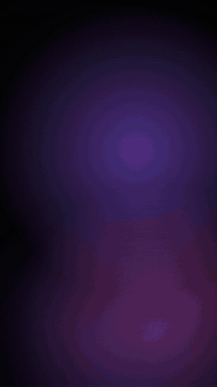
&nbsp;&nbsp;
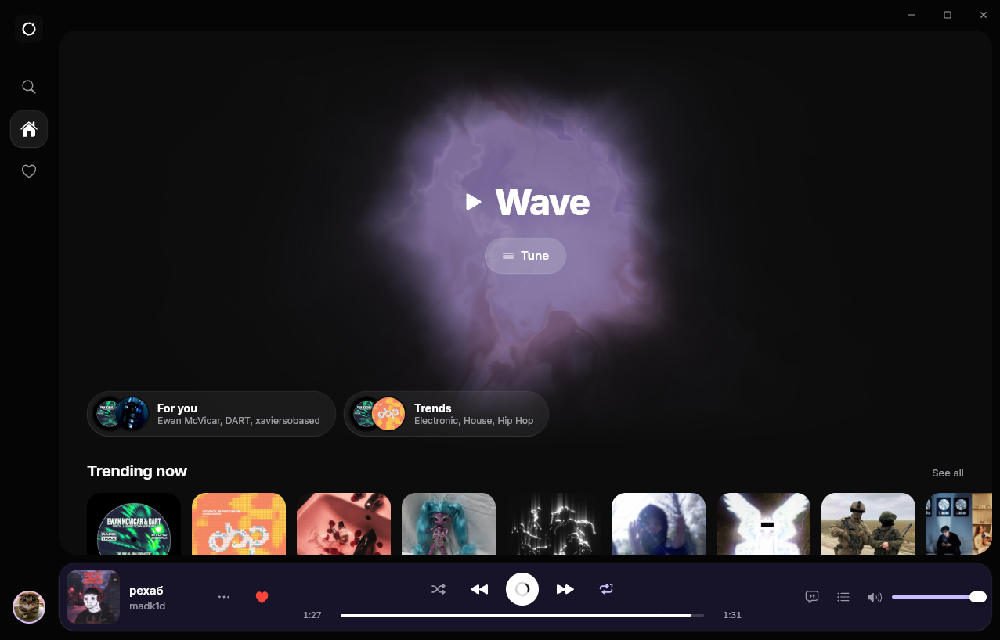

</div>

---

## Главное

<table>
<tr>
<td width="50%" valign="top">

### Волна — бесконечный живой плейлист
Введите артиста, трек, жанр или настроение — Sonara соберёт поток треков, максимально похожих по **стилю** (жанры, теги, граф похожих треков, артисты, длительность), и будет продолжать его бесконечно. Пропуски, лайки и дослушивания перестраивают Волну на ходу. У каждого трека видно, *почему* он выбран.

</td>
<td width="50%" valign="top">

### Настоящий Liquid Glass
Интерфейс построен на **WebGL2‑порте собственного шейдера стекла**: преломление линзы, блик и тень ободка, внутреннее свечение считаются для каждого элемента и накладываются на живую страницу. Переключатели, сегменты, выпадающие меню и шиты в стиле iOS 26 — и плазменная сфера Волны, которая вспыхивает лучами при лайке.

</td>
</tr>
<tr>
<td valign="top">

### Два каталога, одна библиотека
SoundCloud (публичный client id получается автоматически) и YouTube в одном поиске, одной очереди и одних плейлистах. Тренды по жанрам, подборки, чарты YouTube и **«Для вас»** на основе ваших лайков.

</td>
<td valign="top">

### Общение прямо в плеере
**Синхронный текст** (LRCLIB), **комментарии с привязкой ко времени** — нажмите на метку, чтобы перейти к моменту, — и **«Понравилось»** с аватарками слушателей Sonara. Вход через облако (Supabase) или полностью офлайн‑аккаунт на устройстве.

</td>
</tr>
<tr>
<td valign="top">

### Родное на каждой платформе
**Android:** цвета Material You из обоев, тематическая иконка, фоновое воспроизведение с уведомлением и управлением с экрана блокировки.
**Десктоп:** окно без рамки, панель иконок, стеклянный плеер, статус в Discord, экономия памяти при свёрнутом окне.

</td>
<td valign="top">

### Бережно к устройству
Ленивая загрузка бэкенда (клиент YouTube грузится только при необходимости), редкие записи в хранилище, изолированные перерисовки, три уровня графики (Максимум / Сбалансировано / Экономно) с автовыбором и сброс кэшей и GPU‑контекстов в фоне.

</td>
</tr>
</table>

## Скриншоты

<table>
<tr>
<td>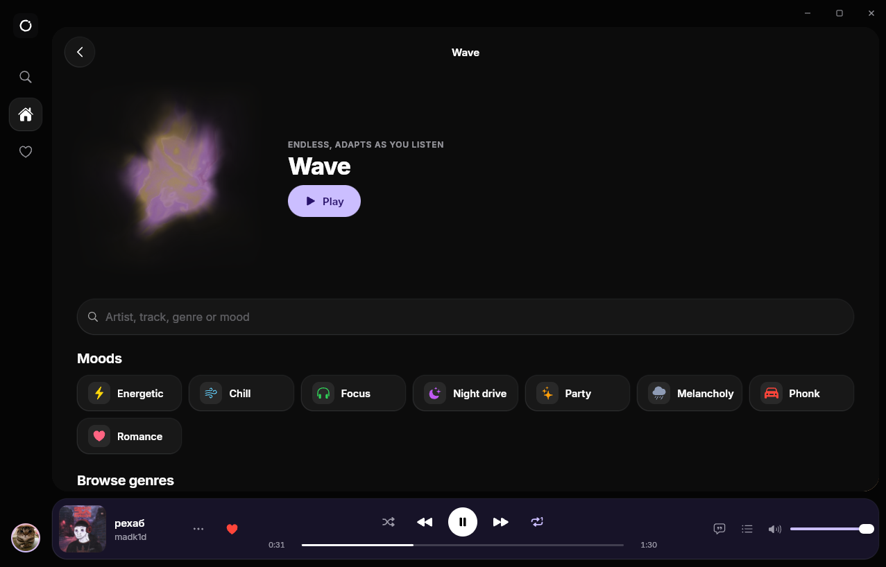<br /><sub><b>Волна</b> — настроения, жанры или любой запрос</sub></td>
<td>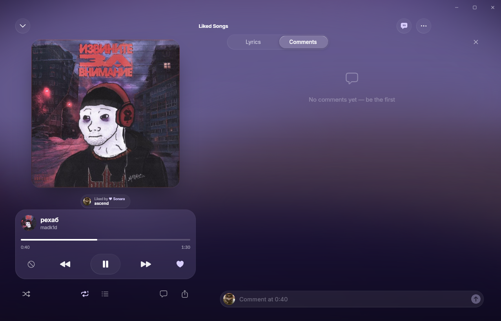<br /><sub><b>Плеер</b> — колонка текста и комментариев</sub></td>
</tr>
<tr>
<td>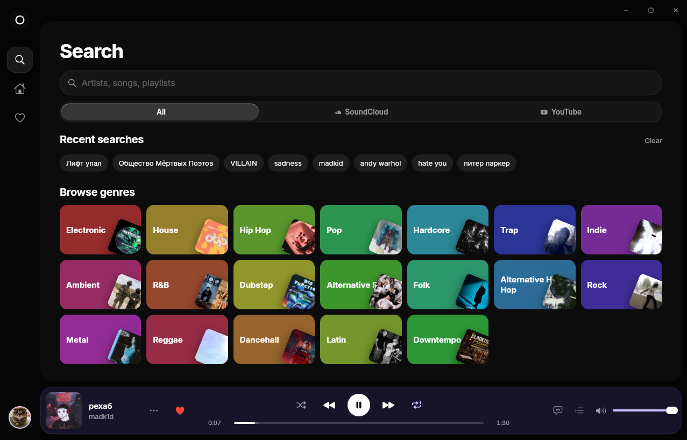<br /><sub><b>Поиск</b> — SoundCloud и YouTube вместе</sub></td>
<td>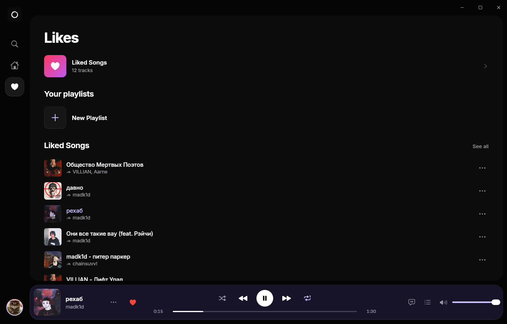<br /><sub><b>Лайки</b> — любимые треки и ваши плейлисты</sub></td>
</tr>
<tr>
<td>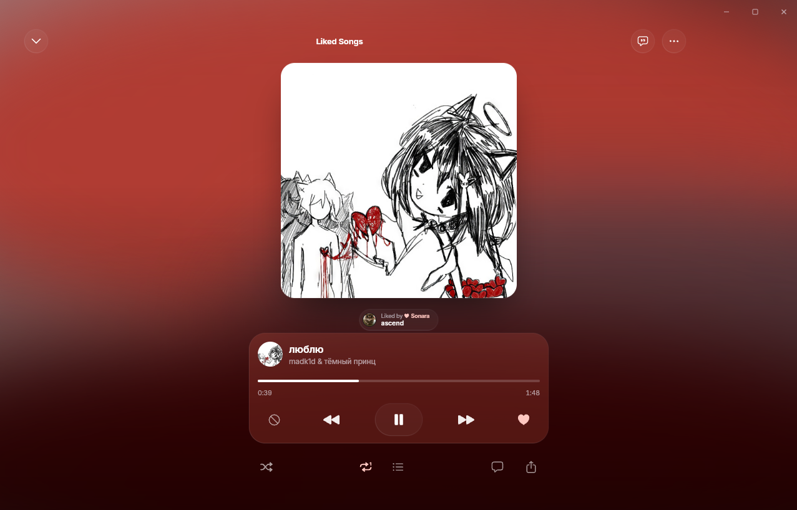<br /><sub><b>Полноэкранный плеер</b> — цвета из обложки</sub></td>
<td>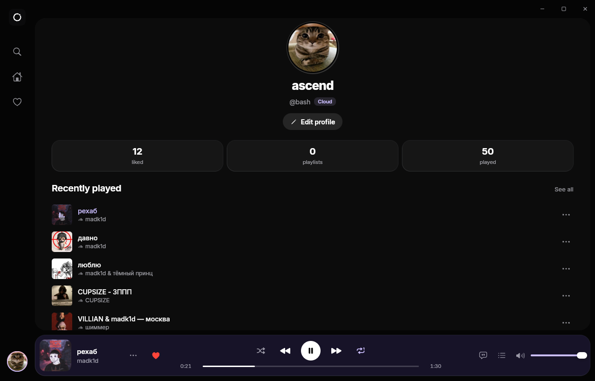<br /><sub><b>Профиль</b> — аватар, username, статистика</sub></td>
</tr>
</table>

<p align="center">
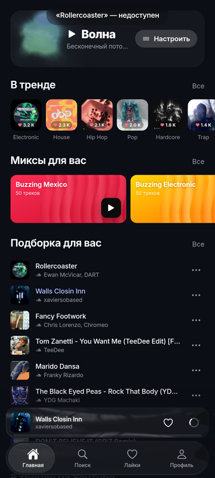
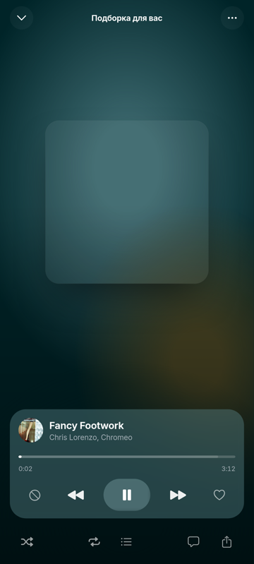
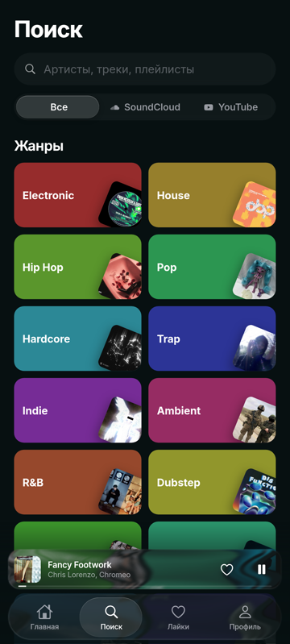
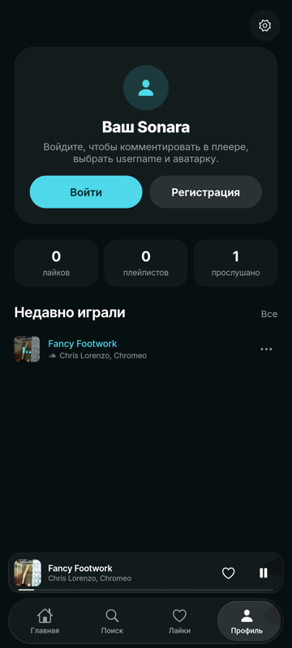
</p>

## Скачать

Последняя версия — на странице **[Releases](https://github.com/Artyom151/sonara/releases/latest)**.

| Платформа | Файл | Примечание |
|---|---|---|
| Android 7.0+ | `Sonara-x.y.z-android.apk` | Разрешите установку из этого источника. `.aab` — для Google Play. |
| iOS 15+ | `Sonara-x.y.z-ios-unsigned.ipa` | Без подписи — установите через AltStore / Sideloadly или подпишите своим сертификатом. |
| Windows 10/11 | `Sonara_x.y.z_x64-setup.exe` или `.msi` | WebView2 поставится автоматически, если его нет. |
| macOS 11+ | `Sonara_x.y.z_universal.dmg` | Apple Silicon и Intel. Без подписи: при первом запуске ПКМ по приложению → **Открыть**. |
| Linux (glibc) | `.AppImage`, `.deb`, `.rpm` | Ubuntu, Debian, Fedora, Arch… Для воспроизведения нужны плагины GStreamer good/bad/libav. |
| Linux (musl) | `Sonara-x.y.z-linux-musl-x86_64.tar.gz` | Alpine и другие musl‑системы — инструкция в `INSTALL.txt` внутри архива. |

## Сборка из исходников

**Нужно:** Node 22+, pnpm 11, а также под нужную платформу: Rust (stable) для десктопа, JDK 21 и Android SDK для Android, Xcode 16 для iOS.

```bash
pnpm install
cp .env.example .env          # необязательно: Supabase и Discord, см. ниже
pnpm dev                      # веб-приложение + локальный API-сервер → http://localhost:5173
```

| Цель | Команда | Результат |
|---|---|---|
| Десктоп (разработка) | `pnpm desktop:dev` | окно Tauri с горячей перезагрузкой |
| Десктоп (релиз) | `pnpm desktop:build` | `src-tauri/target/release/bundle/` |
| Android (debug) | `pnpm android:debug` | `android/app/build/outputs/apk/debug/` |
| Android (релиз) | один раз `pnpm android:keystore`, затем `pnpm android:build` | подписанный `app-release.apk` |
| iOS | `pnpm build && npx cap sync ios && npx cap open ios` | сборка в Xcode |
| Веб (свой сервер) | `pnpm build && pnpm start` | `http://127.0.0.1:8787` |
| Smoke-тест вёрстки телефона | `pnpm build && pnpm smoke:android` | проверка на экранах ~6,1″ → `smoke-results/` |

<details>
<summary><b>Linux и Alpine (musl)</b></summary>

- **Debian/Ubuntu:** `sudo apt install libwebkit2gtk-4.1-dev libgtk-3-dev librsvg2-dev build-essential gstreamer1.0-plugins-good gstreamer1.0-plugins-bad gstreamer1.0-libav`
- **Alpine:** `apk add webkit2gtk-4.1-dev gtk+3.0-dev librsvg-dev build-base gst-plugins-good gst-plugins-bad gst-libav`, затем `pnpm tauri build --no-bundle`. В `src-tauri/.cargo/config.toml` статическая линковка для musl уже отключена.
- **Android на Alpine:** `pnpm android:*` сам находит JDK 21 и использует `aapt2` из SDK (нужен `gcompat`), потому что AAPT2 из Maven работает только с glibc.

</details>

## Настройка

Всё необязательно — без бэкенда Sonara работает с локальным аккаунтом.

| Переменная (`.env`) | Зачем |
|---|---|
| `VITE_SUPABASE_URL`, `VITE_SUPABASE_PUBLISHABLE_KEY` | Облачные аккаунты, комментарии, синхронизация лайков, аватарки. |
| `VITE_DISCORD_APP_ID` | Статус в Discord на десктопе (Application ID из Discord Developer Portal). |
| `VITE_API_BASE` | Только веб‑сборка: адрес удалённого API‑сервера Sonara. |

**Supabase:** выполните по порядку SQL‑файлы из [`supabase/migrations`](supabase/migrations) (Dashboard → SQL Editor или `npx supabase db push`). Они создают профили, комментарии, лайки, хранилище `avatars`, права доступа (RLS) и realtime.

**Discord:** создайте приложение на [discord.com/developers](https://discord.com/developers/applications), укажите его Application ID в `.env` (или в «Настройки → Discord») и загрузите `assets/discord-sonara.png` как art asset Rich Presence с именем `sonara`.

## Как это устроено

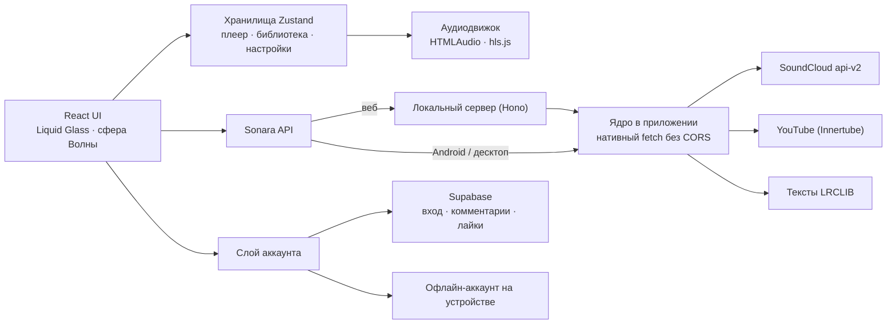

<details>
<summary><b>Структура проекта</b></summary>

```
src/
  core/          бэкенд SoundCloud, YouTube, текстов и рекомендаций (в приложении или в server/)
  player/        аудиодвижок, движок Волны, персональные подборки, анализатор звука
  account/       Supabase и офлайн-провайдеры, комментарии, синхронизация лайков
  ui/            экраны, десктопная оболочка, контролы iOS 26, рантайм Liquid Glass (ui/glass)
  platform/      нативный fetch, уровни графики, сброс памяти, медиауведомление Android, Discord
server/          API-сервер на Hono для веб-сборки
src-tauri/       десктоп (Rust): Discord RPC, уровень памяти WebView2
android/ ios/    проекты Capacitor (плагин Dynamic Color, медиасервис)
supabase/        SQL-миграции
scripts/         иконки, заметки к релизу, синхронизация версии, сборка Android, smoke-тест
```

</details>

## Выпуск релиза

1. Опишите изменения в разделе `## [x.y.z]` **обоих** файлов: [`CHANGELOG.md`](CHANGELOG.md) и [`CHANGELOG_ru.md`](CHANGELOG_ru.md).
2. Создайте и отправьте тег: `git tag v1.1.0 && git push origin v1.1.0`.
3. [`release.yml`](.github/workflows/release.yml) проставит версию во всех манифестах, параллельно соберёт все платформы и опубликует релиз с описанием изменений на английском и русском и списком коммитов.

Необязательные секреты репозитория: `ANDROID_KEYSTORE_BASE64`, `ANDROID_KEYSTORE_PASSWORD`, `ANDROID_KEY_ALIAS`, `ANDROID_KEY_PASSWORD` (подпись релиза; без них APK подписывается debug‑ключом), `VITE_SUPABASE_URL`, `VITE_SUPABASE_PUBLISHABLE_KEY`, `VITE_DISCORD_APP_ID`.

## Технологии

[React 19](https://react.dev) · [Vite](https://vite.dev) · [Tauri 2](https://tauri.app) · [Capacitor 8](https://capacitorjs.com) · [Motion](https://motion.dev) · [Zustand](https://zustand.docs.pmnd.rs) · [Hono](https://hono.dev) · [youtubei.js](https://github.com/LuanRT/YouTube.js) · [hls.js](https://github.com/video-dev/hls.js) · [Supabase](https://supabase.com) · [Material Color Utilities](https://github.com/material-foundation/material-color-utilities) · [LRCLIB](https://lrclib.net) · [Framework7 Icons](https://framework7.io/icons/) (MIT) · [Inter](https://rsms.me/inter/) (OFL)

## Дисклеймер

Sonara — независимый неофициальный клиент. Он **не связан с SoundCloud, YouTube/Google, Discord или Apple и не одобрен ими**. Все треки, обложки и тексты принадлежат их правообладателям и воспроизводятся из оригинальных сервисов; Sonara не хранит и не распространяет контент и не обходит DRM. Использование сторонних сервисов регулируется их условиями.

## Лицензия

[Apache License 2.0](LICENSE) © участники проекта Sonara — см. также [NOTICE](NOTICE)
